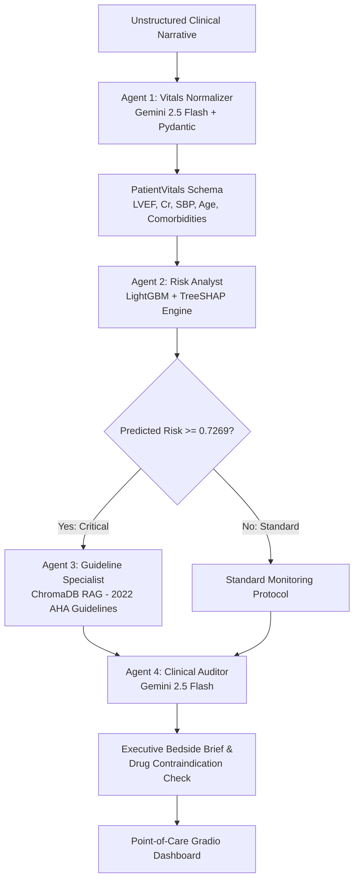

# Project ACAT: Acute Care Agentic Triage

**Project ACAT** is an end-to-end Clinical Decision Support System (CDSS) designed for emergency department triage and 30-day cardiovascular deterioration stratification. It integrates the **OMOP Common Data Model (CMS Synthetic Public Schema)**, a cost-sensitive **LightGBM** classifier with observation-level **TreeSHAP** attributions, a semantic vector store indexing the **2022 AHA/ACC/HFSA Heart Failure Guidelines**, and a 4-agent consensus engine driven by **Gemini 2.5 Flash**.

---

## 1. System Architecture

