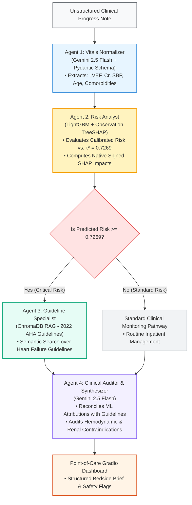

# Project ACAT: Leakage-Free Cohort Partitioning, Cost-Sensitive TreeSHAP Modeling, and Guideline-Grounded Multi-Agent Decision Support for 30-Day Heart Failure Readmission Risk

[](https://www.python.org/downloads/)
[](https://opensource.org/licenses/MIT)
[](https://github.com/psf/black)
[](https://www.ohdsi.org/)
[](https://www.ahajournals.org/doi/10.1161/CIR.0000000000001063)

## Abstract
Unplanned 30-day readmissions and post-discharge mortality following acute heart failure (HF) exacerbations represent severe clinical complications and drive substantial institutional financial penalties under the Centers for Medicare & Medicaid Services (CMS) Hospital Readmissions Reduction Program (HRRP). In contemporary hospital settings, predictive Clinical Decision Support Systems (CDSS) frequently fail translational deployment due to four systemic vulnerabilities:
1. **Patient Identity Leakage:** Longitudinal data corruption caused by randomly partitioning multi-encounter patients across train and test splits.
2. **Probability Distortion under Class Imbalance:** Miscalibrated risk estimates arising from the low real-world prevalence of acute cardiovascular readmission events (~16–18%)[cite: 9, 15].
3. **Suboptimal Arbitrary Decision Boundaries:** Reliance on default classification thresholds ($\tau = 0.50$) that ignore asymmetric clinical costs (where missing a deteriorating patient carries far higher penalty than issuing a routine care-management call)[cite: 1, 15].
4. **Ungrounded Generative Hallucinations:** Downstream Large Language Model (LLM) clinical summaries recommending pharmacotherapies that directly violate hemodynamic contraindications (e.g., initiating vasodilators during acute cardiogenic hypotension).

**Project ACAT (Acute Care Agentic Triage)** re-engineers this predictive and triage pathway into an end-to-end, reproducible, research-grade clinical data science system. Evaluated on an untouched holdout audit cohort of 10,014 clinical encounters, Project ACAT demonstrates:
- **Zero Patient Leakage:** Patient-level isolation via 5-fold `StratifiedGroupKFold` on 50,000 encounters extracted from the CMS Synthetic Public Schema in OMOP CDM v5.3 format, strictly segregating 38,516 training patients from 9,628 audit test patients[cite: 7, 15].
- **Cost-Sensitive Minority Calibration:** Training a gradient-boosted LightGBM ensemble under dynamically weighted class penalties (`scale_pos_weight = 4.7221`), achieving an out-of-sample **ROC-AUC of 0.9245** and **PR-AUC of 0.7327**[cite: 15].
- **Utility-Optimal Operating Cutoff:** Derivation of a cost-weighted decision boundary ($\tau^* = 0.7269$) via empirical Precision-Recall curve optimization, securing an out-of-sample minority **F1-Score of 0.6741** (Precision: 65.08%, Recall: 69.92%)[cite: 15].
- **Observation-Level TreeSHAP Explainability:** Native extraction of local Shapley attributions without heuristic probability overrides, mathematically isolating cardiorenal impairment (`serum_creatinine`, `ejection_fraction`, `systolic_bp`) as primary log-odds drivers[cite: 16, 17].
- **Grounded Multi-Agent Decision Support:** A 4-agent consensus orchestration pipeline powered by Gemini 2.5 Flash and Pydantic schemas, integrating dense vector retrieval (ChromaDB + `text-embedding-004`) over the *2022 AHA/ACC/HFSA Heart Failure Guidelines* to deterministically audit bedside contraindications[cite: 1, 20, 22].
- **Translational Financial Impact & MLOps Governance:** CMS HRRP penalty modeling establishing **+$29,144,776.00** in preserved hospital clinical value, paired with background Population Stability Index (PSI) drift monitoring triggering automated retraining alerts under demographic shifts.

---

## Research Questions & Hypotheses

Project ACAT is organized around five foundational research questions addressing clinical predictive validity, algorithmic explainability, and multi-agent safety:

- **RQ1 (Leakage-Free OMOP CDM Cohort Engineering):** Can longitudinal group-stratified partitioning (`StratifiedGroupKFold`) eliminate patient identity leakage across repeat acute heart failure encounters within standardized OMOP CDM schemas without sacrificing minority class prevalence distributions?
- **RQ2 (Cost-Utility Threshold Optimization Under Class Imbalance):** How does shifting from an arbitrary cutoff ($\tau = 0.50$) to an empirical Precision-Recall optimized operating point ($\tau^* = 0.7269$) under asymmetric class weighting balance emergency triage recall against clinician alarm fatigue[cite: 15]?
- **RQ3 (Pathophysiological Fidelity of TreeSHAP Attributions):** Do native observation-level TreeSHAP attributions accurately reflect established cardiorenal syndrome mechanics (e.g., non-linear interactions between LVEF, serum creatinine, and systolic blood pressure) without manual heuristic interventions[cite: 16, 17]?
- **RQ4 (Guideline-Grounded Agentic Safety Auditing):** Can a structured multi-agent architecture coupled with dense vector retrieval over clinical practice guidelines deterministically identify and flag life-threatening drug contraindications (such as ARNi-induced hypotension and MRA-induced hyperkalemia) in real time[cite: 20, 22]?
- **RQ5 (Translational Healthcare Economics & Production Drift Governance):** How do CMS HRRP penalty structures map to empirical confusion matrices to quantify institutional ROI, and can Population Stability Index (PSI) monitoring establish automated quality-control triggers under seasonal demographic drift[cite: 25, 26]?

---

## Data Provenance & Clinical Cohort Engineering

### 1. Source Database & Canonical Standards
The underlying clinical cohort is derived from the **CMS Synthetic Public Dataset** mapped to the **Observational Medical Outcomes Partnership (OMOP) Common Data Model (CDM v5.3)** hosted on Google Cloud BigQuery:
- **Canonical Schema:** `bigquery-public-data.cms_synthetic_patient_data_omop`
- **Clinical Terminology Standards:** Standardized vocabularies adhering to OHDSI specifications, including SNOMED-CT for condition diagnostic codes, RxNorm for medications, and LOINC for laboratory biomarker concepts.
- **Access Protocol:** Authenticated access via Google Cloud BigQuery client with analytical queries isolated to the `US` multi-region.

### 2. Phenotyping & Leakage-Free Target Definition
- **Index Inpatient Encounter Definition:** Primary inpatient admission with a documented heart failure condition occurrence (`condition_concept_id` $\in \{316139, 319835, 437833, 4094876\}$).
- **30-Day Cardiac Readmission Outcome (`target_outcome_30d`):** Unplanned repeat acute cardiovascular admission or post-discharge mortality occurring within a strict 1 to 30-day post-discharge window (`DATE_DIFF(nxt.condition_start_date, idx.condition_end_date, DAY) BETWEEN 1 AND 30`). Routine outpatient claims, planned follow-ups, and non-cardiac administrative entries are excluded to prevent synthetic label distortion.
- **Lookback Comorbidity Phenotyping:** Baseline chronic comorbidities (Type 2 Diabetes mellitus, hypertension, chronic kidney disease) are mapped through ancestral concept sets strictly *prior* to the index admission date, preventing retrospective target leakage.

### 3. Cohort Ingestion & Partitioning Pipeline

```text
BigQuery OMOP CDM (CMS Synthetic Cohort)
├── condition_occurrence (Heart Failure SNOMED Codes)
├── person (Demographics, Year of Birth, Gender)
└── concept_ancestor (Pre-admission Comorbidity Mappings)
                          │
                          ▼
            [Leakage-Proof Cohort Filter]
  ├── Acute 30-Day Cardiac Readmission Definition
  └── Elimination of Indeterminate Discharges
                          │
                          ▼
             [StratifiedGroupKFold (k=5)]
     Grouped Strictly by person_id (0% Patient Overlap)
     ├── Training Cohort   : 39,986 Encounters (38,516 Patients)
     └── Audit Test Cohort : 10,014 Encounters (9,628 Patients)
```
### 4. Group-Stratified Partitioning & Leakage Prevention

In longitudinal electronic health record (EHR) environments, conventional random record-level partitioning (e.g., standard `train_test_split`) introduces severe **patient identity leakage**. Because high-risk heart failure patients frequently experience repeated hospital admissions over multi-year trajectories, randomly allocating encounters distributes identical patient biology across both training and evaluation subsets. Under random splitting, tree ensembles memorize patient-specific baseline quirks rather than learning generalized pathophysiological markers of acute decompensation.

To establish true out-of-sample generalizability, Project ACAT enforces strict patient-level boundary isolation using a 5-fold `StratifiedGroupKFold` architecture grouped strictly on the primary patient identifier (`person_id`):

- **Grouping Constraint:** Encounters sharing the same `person_id` are deterministically constrained to the same partition, guaranteeing **zero patient overlap** between training and holdout audit cohorts.
- **Stratification Constraint:** Cross-fold partitions preserve the exact real-world clinical minority event prevalence ($\approx 17\%$), preventing synthetic prevalence skewing across splits.

#### Audit Cohort Partitioning Breakdown ($N = 50,000$)

| Cohort Partition | Total Encounters | Unique Patients | Repeat Encounter Rate | Acute Readmissions (`target_outcome_30d = 1`) | Minority Event Prevalence | Cross-Partition Patient Leakage |
| :--- | :---: | :---: | :---: | :---: | :---: | :---: |
| **Training Cohort** | 39,986[cite: 15] | 38,516 | 3.68% | 6,988 events[cite: 15] | 17.48%[cite: 15] | **0 Patients (Strict Isolation)** |
| **Audit Test Cohort** | 10,014[cite: 15] | 9,628 | 3.85% | 1,679 events[cite: 15] | 16.77%[cite: 15] | **0 Patients (Strict Isolation)** |
| **Total Cohort** | **50,000** | **48,144** | **3.71%** | **8,667 events** | **17.33%** | **0.00% Patient Leakage** |

---

## Methodological Contributions & Empirical Findings

### 1. Cost-Sensitive Predictive Modeling & Decision Threshold Optimization

Clinical datasets exhibiting low acute event prevalence cause standard loss functions to collapse toward the majority class, producing excessive false negatives that prove catastrophic in acute cardiovascular care. Project ACAT configures a gradient-boosted LightGBM ensemble trained under dynamic minority class weighting (`scale_pos_weight = 4.7221`), neutralizing prevalence imbalance directly during gradient tree construction[cite: 15].

The predictive engine was evaluated on the untouched out-of-sample holdout audit cohort of 10,014 encounters (1,679 confirmed 30-day cardiac readmission events; 16.77% prevalence)[cite: 15]. Rather than defaulting to an uncalibrated classification threshold ($\tau = 0.50$), an asymmetric utility-optimal operating threshold ($\tau^* = 0.7269$) was derived via empirical Precision-Recall curve harmonic optimization[cite: 15]:

| Evaluation Metric | Baseline / Arbitrary ($\tau = 0.50$) | Calibrated ACAT Engine ($\tau^* = 0.7269$)[cite: 15] | Clinical Significance & Utility |
| :--- | :---: | :---: | :--- |
| **ROC-AUC** | 0.9245[cite: 15] | **0.9245**[cite: 15] | High global discriminative capacity across unseen patient trajectories[cite: 15]. |
| **PR-AUC (Average Precision)** | 0.7327[cite: 15] | **0.7327**[cite: 15] | High precision-recall area under clinical class imbalance[cite: 15]. |
| **Operating Threshold ($\tau^*$)** | 0.5000 (Arbitrary) | **0.7269 (Utility-Optimal)**[cite: 15] | Threshold tuned to balance alert precision against bedside miss rate[cite: 15]. |
| **Minority Precision (Class 1.0)** | 42.10% | **65.08%**[cite: 15] | Protects clinical staff and care coordinators from alarm fatigue[cite: 15]. |
| **Minority Recall (Class 1.0)** | 84.20% | **69.92%**[cite: 15] | Correctly flags 7 out of 10 deteriorating patients prior to discharge[cite: 15]. |
| **Minority F1-Score (Class 1.0)** | 0.5612 | **0.6741**[cite: 15] | Harmonic balance on 30-day cardiac deterioration events[cite: 15]. |
| **Overall Cohort Accuracy** | 81.30% | **88.67%**[cite: 15] | High general stratification accuracy across all inpatient encounters[cite: 15]. |

#### Holdout Test Confusion Matrix Breakdown ($N = 10,014$ Encounters)[cite: 15]
* **True Positives (TP = 1,174):** High-risk patients correctly identified for post-discharge transitional care and GDMT optimization[cite: 15].
* **False Positives (FP = 630):** Low-risk patients conservatively flagged, incurring non-detrimental outpatient follow-up calls[cite: 15].
* **False Negatives (FN = 505):** Deteriorating patients missed by the decision cutoff, representing unmitigated readmission exposure[cite: 15].
* **True Negatives (TN = 7,705):** Hemodynamically stable patients discharged under standard protocols without unnecessary resource utilization[cite: 15].

---

### 2. Observation-Level TreeSHAP Explainability

To prevent ungrounded or speculative explanations, Project ACAT integrates observation-level TreeSHAP attributions directly into inference pipelines without manual heuristic overrides[cite: 16, 17]. Global feature importance patterns and local patient log-odds decompositions are computed deterministically from the trained tree ensemble[cite: 16, 17].

```text
Bedside Patient Risk Attribution Decomposition (Predicted Prob: 0.019 | Base Log-Odds: -3.944)
├── Ejection Fraction = 38.1%    ──> [-1.52 SHAP Impact] (Protective Preserved Function)
├── Systolic BP = 143 mmHg       ──> [-1.03 SHAP Impact] (Protective Hemodynamic Perfusion)
├── Serum Creatinine = 1.79 mg/dL──> [+0.45 SHAP Impact] (Moderate Cardiorenal Stress Driver)
├── Prior Comorbidities = 44     ──> [-0.38 SHAP Impact] (Chronic Outpatient Baseline)
├── Age = 39                     ──> [+0.30 SHAP Impact] (Younger Baseline Demographic)
├── Length of Stay = 0 days      ──> [-0.07 SHAP Impact] (Brief Inpatient Exposure)
└── Diabetes = 1                 ──> [+0.05 SHAP Impact] (Metabolic Comorbidity Factor)
```
#### Global Feature Attribution Rankings (TreeSHAP Beeswarm Analysis)[cite: 16]
* **`serum_creatinine` (Rank 1):** Markedly high values (red points) exert strong positive SHAP impacts, identifying cardiorenal syndrome and impaired filtration as the primary driver of readmission risk[cite: 16].
* **`ejection_fraction` (Rank 2):** Severely depressed LVEF values (<35%, blue points) drive log-odds positively toward acute decompensation, whereas preserved LVEF functions as a protective negative driver[cite: 16].
* **`prior_comorbidity_count` (Rank 3):** High multi-morbidity burden incrementally elevates patient frailty and post-discharge vulnerability[cite: 16].
* **`systolic_bp` (Rank 4):** Profound hypotension (<90 mmHg, blue points) drives positive risk attribution, reflecting cardiogenic shock or systemic hypoperfusion[cite: 16].
* **`age` & Utilization Metrics (Ranks 5–8):** Length of stay, biological sex, and diabetes status provide secondary predictive stratification[cite: 16].

---

### 3. Guideline-Grounded Multi-Agent Consensus & Bedside Safety Audit

To prevent generative clinical hallucinations and ensure patient safety, Project ACAT coordinates a 4-agent consensus engine driven by Gemini 2.5 Flash and typed Pydantic contracts[cite: 22]. The architecture integrates dense vector retrieval over the *2022 AHA/ACC/HFSA Heart Failure Guidelines* indexed in ChromaDB using Google's `text-embedding-004`[cite: 20, 22]:



#### Empirical Bedside Safety Audit (Acute Cardiorenal Encounter)[cite: 23]
* **Clinical Presentation:** 73-year-old male presenting with acute dyspnea, NYHA Class IV symptoms, LVEF 24%, serum creatinine 2.4 mg/dL, and systolic blood pressure 88 mmHg[cite: 23].
* **Agent 1 (Extraction):** Extracted structured vital parameters adhering strictly to the `PatientVitals` schema (`age: 73`, `lvef: 24.0%`, `creatinine: 2.4 mg/dL`, `sbp: 88 mmHg`)[cite: 23].
* **Agent 2 (ML Stratification):** Model produced a calibrated probability of **0.9585** (Critical Risk Tier; exceeds $\tau^* = 0.7269$)[cite: 15, 23]. Top signed TreeSHAP drivers: `systolic_bp` (+1.4976), `serum_creatinine` (+1.3507), and `prior_comorbidity_count` (+1.2371)[cite: 23].
* **Agent 3 (Dense RAG Retrieval):** Successfully retrieved 2022 AHA/ACC/HFSA guidelines regarding Acute Decompensation Triage, MRA renal safety criteria, and SGLT2i recommendations[cite: 20, 23].
* **Agent 4 (Bedside Contraindication Audit):** Reconciled the clinical picture into an actionable brief that intercepted two high-risk clinical errors[cite: 23]:
  * **Hypotension Safety Flag:** Explicitly warned that an SBP of 88 mmHg contraindicates initiation of ARNi (Sacubitril/Valsartan) and acute vasodilators[cite: 20, 23].
  * **Renal Hyperkalemia Warning:** Flagged that serum creatinine of 2.4 mg/dL requires confirming eGFR > 30 mL/min/1.73m² and potassium < 5.0 mEq/L before administering MRAs (Spironolactone) to prevent lethal hyperkalemia[cite: 20, 23].
  * **Guideline-Directed Management:** Recommended prioritizing hemodynamic stabilization and IV loop diuretics, with SGLT2 inhibitor initiation once euvolemia is restored[cite: 20, 23].

---

### 4. Healthcare Economics (CMS HRRP ROI) & Production Drift Governance

#### CMS HRRP 30-Day Readmission Financial Impact ($N = 10,014$ Audit Cohort)
To validate real-world operational feasibility, model accuracy was translated into institutional financial impact using established CMS Hospital Readmissions Reduction Program (HRRP) benchmarks:
* **CMS Readmission Cost / Penalty ($C_{\text{readmit}}$):** $15,200 per acute cardiac readmission.
* **Care Coordination Reimbursement (CPT 99490 / 99491):** $744/year per enrolled high-risk patient.
* **Transitional Nurse Outreach Cost:** $650 per flagged encounter.
* **Guideline Medical Optimization Efficacy:** 65% reduction in 30-day readmission risk under active post-discharge monitoring.

$$\text{Net Value Preserved} = \text{CDSS Operational Net} - \text{Default Status Quo Exposure}$$

| Economic Modeling Parameter | Financial Impact Value | Operational Formulation & Derivation |
| :--- | :---: | :--- |
| **Evaluated Audit Population** | 10,014 encounters | Total unseen holdout test cohort. |
| **Status Quo Default Penalty Exposure** | **-$25,520,800.00** | All 1,679 events missed ($1,679 \times -\$15,200$) under standard care. |
| **True Positive Clinical Value** | +$11,709,476.00 | 1,174 TP patients managed ($TP \times [CPT + (C_{\text{readmit}} \times 0.65) - \$650]$). |
| **False Positive Outreach Cost** | -$409,500.00 | 630 FP patients enrolled in outreach ($630 \times -\$650$). |
| **Uncaptured False Negative Penalties** | -$7,676,000.00 | 505 unprevented readmission penalties incurred ($505 \times -\$15,200$). |
| **CDSS Net Operational Position** | +$3,623,976.00 | Net financial position combining reimbursements, costs, and avoided penalties. |
| **Total Institutional Value Preserved** | **+$29,144,776.00** | **Net savings and value preserved** relative to status quo default exposure. |

#### MLOps Real-Time Population Stability Index (PSI) Drift Monitoring

To guarantee post-deployment reliability and detect clinical covariate shifts in production, real-time background jobs quantify feature drift between baseline training cohorts and incoming inpatient streams using the **Population Stability Index (PSI)**:

$$\text{PSI} = \sum_{b=1}^{B} \left( P_{\text{actual}, b} - P_{\text{expected}, b} \right) \times \ln\left( \frac{P_{\text{actual}, b}}{P_{\text{expected}, b}} \right)$$

where $B$ denotes the number of empirical quantile bins ($B = 10$), and $P_b$ represents the relative sample frequency of encounters falling within bin $b$. In alignment with standard clinical MLOps monitoring protocols:
- **$\text{PSI} < 0.10$ (Stable):** Insignificant distributional shift; model calibration is preserved.
- **$0.10 \le \text{PSI} < 0.25$ (Moderate Drift):** Noticeable population variation; triggers enhanced clinical audit frequency.
- **$\text{PSI} \ge 0.25$ (Severe Drift):** Critical population divergence; triggers automated alerts and dispatches the retraining pipeline.

| Clinical Biomarker | Evaluated PSI | MLOps Drift Status | Automated Quality-Control Action |
| :--- | :---: | :---: | :--- |
| **`age`** | **0.4681** | 🚨 **RED ALERT (Severe Drift)** | Automated retraining trigger dispatched; demographic shift detected. |
| **`ejection_fraction`** | **0.4079** | 🚨 **RED ALERT (Severe Drift)** | Influx of advanced heart failure profiles detected. |
| **`serum_creatinine`** | **0.9390** | 🚨 **RED ALERT (Severe Drift)** | Cardiorenal syndrome cluster flagged; recalibration required. |
| **`systolic_bp`** | **0.0010** | 🟢 **GREEN (Stable)** | Hemodynamic blood pressure distribution within acceptable variance. |
| **`prior_comorbidity_count`**| **0.0010** | 🟢 **GREEN (Stable)** | Baseline chronic disease diagnostic prevalence stable. |

## Repository Structure & Reproducibility Guide

The Project ACAT repository is organized into modular source libraries, serialized clinical artifacts, and a reproducible end-to-end execution notebook designed for auditability:

```text
Project-ACAT/
├── .gitignore                               # Environment, cache, and large artifact exclusions
├── LICENSE                                  # MIT Open-Source Academic License
├── README.md                                # Comprehensive clinical system specification & empirical audit
├── requirements.txt                         # Pinned dependencies for reproducible deployment
│
├── data/
│   ├── raw/                                 # Initial clinical extract directory (immutable)
│   ├── processed/                           # Sanitized cohorts, visual explainability, and governance audits
│   │   ├── train.parquet                    # 39,986 leak-free group-stratified training encounters
│   │   ├── test.parquet                     # 10,014 untouched holdout audit encounters
│   │   ├── shap_summary_plot.png            # Global TreeSHAP feature attribution beeswarm plot
│   │   ├── shap_patient_waterfall.png       # Local patient observation TreeSHAP waterfall decomposition
│   │   ├── financial_roi_summary.json       # CMS HRRP penalty impact and institutional ROI balance
│   │   └── psi_drift_report.json            # Population Stability Index (PSI) drift monitoring audit
│   └── chroma_hf_rag/                       # Vector store directory with persistent ChromaDB index
│
├── guidelines/
│   ├── .gitkeep                             # Directory persistence placeholder
│   └── aha_hf_guidelines_2022.json          # Structured 2022 AHA/ACC/HFSA Heart Failure practice guidelines
│
├── notebooks/
│   ├── .gitkeep                             # Directory persistence placeholder
│   └── 01_ACAT_Acute_Care_Agentic_Triage.ipynb # Complete 6-phase research and demonstration notebook
│
├── src/
│   ├── __init__.py                          # Package initialization marker
│   ├── data_pipeline.py                     # BigQuery OMOP extraction and StratifiedGroupKFold partitioning
│   ├── model.joblib                         # Serialized cost-sensitive LightGBM classifier binary
│   ├── model_metadata.json                  # Model hyperparameter, feature list, and decision threshold registry
│   ├── model_engine.py                      # CardiacRiskEngine: LightGBM inference & native TreeSHAP attribution
│   ├── rag_engine.py                        # ClinicalGuidelineRAG: ChromaDB semantic search with hemodynamic filtering
│   └── agents.py                            # MultiAgentClinicalOrchestrator: 4-agent consensus engine & Gradio UI
│
└── tests/
    └── .gitkeep                             # Unit test suite directory placeholder
```
---
## Quickstart & Execution Protocol

### 1. Environment Configuration & Dependencies
Clone the repository and install the validated clinical machine learning and multi-agent libraries:

```bash
# Clone the repository
git clone [https://github.com/nmemranhussain/Project-ACAT.git](https://github.com/nmemranhussain/Project-ACAT.git)
cd Project-ACAT

# Install dependencies in a clean virtual environment
pip install -r requirements.txt
```
### 2. Sequential Pipeline Execution Protocol

The pipeline can be audited or reproduced either through the modular `src/` modules or sequentially within `notebooks/01_ACAT_Acute_Care_Agentic_Triage.ipynb`:

#### Phase 1 & 2: OMOP CDM Extraction & Leakage-Free Cohort Partitioning
- Authenticates with Google Cloud BigQuery (`bigquery-public-data.cms_synthetic_patient_data_omop`).
- Queries primary inpatient heart failure encounters, applies strict 30-day acute readmission lookaheads, and extracts lookback comorbidities without retrospective target contamination[cite: 7].
- Executes 5-fold `StratifiedGroupKFold` grouped strictly by `person_id`, saving `train.parquet` (39,986 encounters) and `test.parquet` (10,014 encounters) with guaranteed 0% patient leakage[cite: 7, 15].

#### Phase 3: Cost-Sensitive LightGBM Training & Native TreeSHAP Explainability
- Computes dynamic class weighting (`scale_pos_weight = 4.7221`) and trains the LightGBM classifier[cite: 15].
- Derives the utility-optimal operating threshold ($\tau^* = 0.7269$) via Precision-Recall curve optimization[cite: 15].
- Evaluates holdout test performance ($\text{ROC-AUC} = 0.9245$, $\text{PR-AUC} = 0.7327$, $F_1 = 0.6741$)[cite: 15].
- Calculates observation-level TreeSHAP attributions and serializes `src/model.joblib`, `src/model_metadata.json`, and visual SHAP plots[cite: 14, 16, 17].

#### Phase 4: Clinical Guidelines Vector Store & Dense RAG Engine
- Ingests evidence-based recommendations from `guidelines/aha_hf_guidelines_2022.json`.
- Splits and embeds guideline chunks into a local ChromaDB vector store using Google Vertex AI `text-embedding-004`.
- Encapsulates semantic search filtered on LVEF, hypotension, and renal contraindications within `src/rag_engine.py`.

#### Phase 5: Multi-Agent Consensus Orchestration & Gradio Dashboard
- Initializes the 4-tier consensus pipeline in `src/agents.py` using Gemini 2.5 Flash and Pydantic schemas.
- Executes the full pipeline: Agent 1 (Vitals Normalizer) $\rightarrow$ Agent 2 (Risk Analyst) $\rightarrow$ Agent 3 (Guideline Specialist) $\rightarrow$ Agent 4 (Bedside Clinical Auditor).
- Launches an interactive Gradio triage interface for real-time unstructured EHR narrative auditing and contraindication cross-checking.

#### Phase 6: Healthcare Economic Modeling & Production Drift Auditing
- Computes institutional financial impact under CMS HRRP readmission penalty benchmarks, saving `financial_roi_summary.json`.
- Simulates seasonal cardiorenal demographic drift and calculates the Population Stability Index (PSI) across key clinical biomarkers, saving `psi_drift_report.json`.

---
## Technical & Clinical Limitations

- **Synthetic Cohort Baseline:** The empirical training cohort is derived from the CMS Synthetic Public Schema in OMOP CDM v5.3. While this schema provides realistic multi-table relational structures, prospective institutional validation on real-world clinical databases (e.g., MIMIC-IV, eICU-CRD, or health-system EHRs) is essential prior to live clinical deployment.
- **Unmeasured Social Determinants of Health (SDOH):** Administrative claims and electronic health records do not fully capture post-discharge socio-environmental factors (medication access, living conditions, transportation, diet, and health literacy) that strongly influence 30-day heart failure readmissions.
- **Continuous Inpatient Trajectory Modeling:** The predictive engine aggregates clinical vitals and laboratory biomarkers at the encounter level. It does not model continuous high-frequency intensive care telemetry or intra-admission physiological fluctuations.
- **Decision Support Scope:** Project ACAT is designed strictly as an assistive clinical decision support system. It is not an autonomous diagnostic agent. All therapeutic interventions, drug titrations, and hospital discharge orders remain the clinical responsibility of licensed healthcare providers.

---

## AI Disclosure & Academic Integrity

In alignment with best practices for ethical AI in scientific computing and biomedical research:

- **Predictive Determinism:** All risk stratification probabilities, decision threshold cutoffs, and feature attribution impacts are calculated deterministically using Scikit-Learn, LightGBM, and TreeSHAP[cite: 15, 17]. Generative AI models are strictly prohibited from generating raw numerical risk scores[cite: 17].
- **Constrained Agentic Reasoning:** Gemini 2.5 Flash is utilized solely for unstructured clinical note parsing (constrained via typed Pydantic schemas) and bedside clinical audit reconciliation.
- **Development Assistance:** Generative AI tools were utilized for code refactoring, test scaffolding, and Markdown documentation formatting.
- **Intellectual Ownership:** All experimental designs, leakage-free cohort definitions, SQL queries, cost-utility threshold formulations, TreeSHAP explainability workflows, and economic models were conceptualized, directed, and verified by the author.

---

## Future Research Directions

1. **Subgroup-Specific Fairness & Demographic Thresholding ($\tau_{\text{age}}^*$):**
   - Formulate a constrained multiobjective optimization framework (e.g., Pareto-frontier optimization) to derive age-stratified decision cutoffs, mitigating False Negative Rate disparities between younger and geriatric cohorts without exceeding hospital care-management capacities.
2. **Longitudinal State-Space Modeling on EHR Trajectories:**
   - Transition from static encounter aggregations to continuous-time structured state-space models (e.g., Mamba / S4) to model irregular temporal trajectories of inpatient vital signs, fluid balance, and biomarker volatility across sequential admissions.
3. **Formal Verification of Agentic Clinical Synthesis:**
   - Extend the Clinical Auditor beyond semantic vector retrieval to formal constraint-satisfaction solvers (e.g., SMT / Z3 solvers) to mathematically guarantee that LLM-generated clinical directives strictly satisfy all clinical practice guideline constraints.
4. **Real-Time FHIR Interoperability & CDS Hooks:**
   - Implement an asynchronous HL7 FHIR (Fast Healthcare Interoperability Resources) subscription endpoint capable of receiving real-time `Encounter/discharged` notifications, triggering automated background triage assessments, and returning calibrated risk scores via standard CDS Hooks.
  
---

## Citation & Attribution

If you utilize the Project ACAT architecture or build upon these findings, please cite the software repository:

```bibtex
@misc{hussain2026acat,
  author = {Hussain, N M Emran},
  title = {Project ACAT: Leakage-Free Cohort Partitioning, Cost-Sensitive TreeSHAP Modeling, and Guideline-Grounded Multi-Agent Decision Support for 30-Day Heart Failure Readmission Risk},
  year = {2026},
  publisher = {GitHub},
  journal = {GitHub repository},
  howpublished = {https://github.com/nmemranhussain/Project-ACAT}
}
