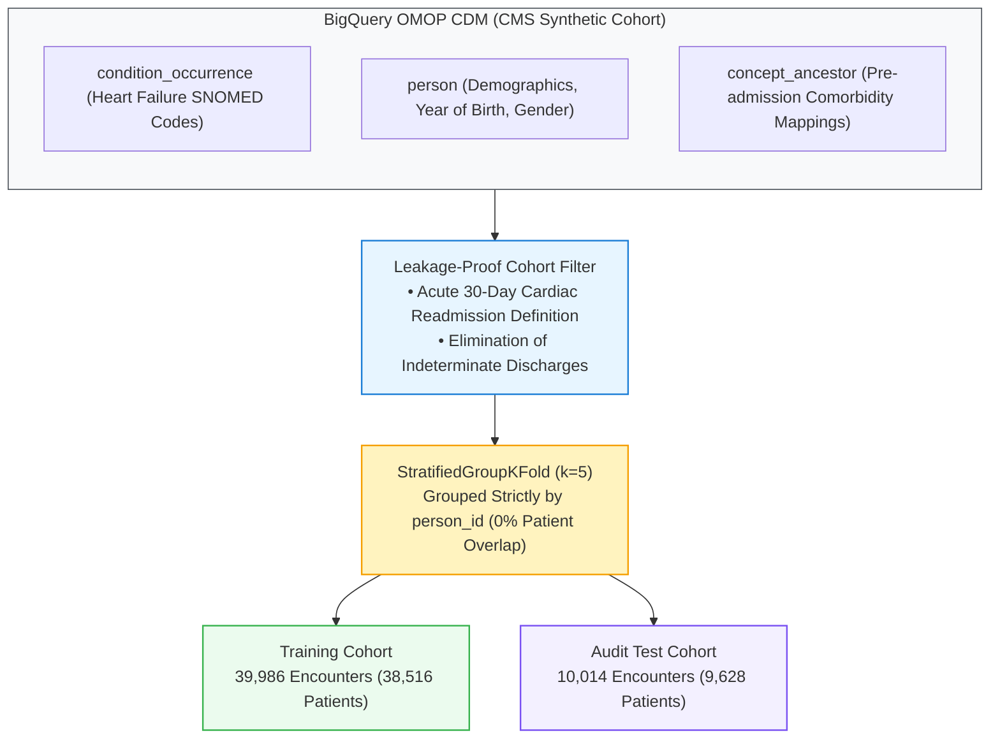
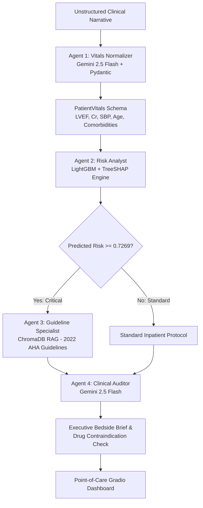

# Project ACAT: Leakage-Free Cohort Partitioning, Cost-Sensitive TreeSHAP Modeling, and Guideline-Grounded Multi-Agent Decision Support for 30-Day Heart Failure Readmission Risk

[](https://www.python.org/downloads/)
[](https://opensource.org/licenses/MIT)
[](https://github.com/psf/black)
[](https://www.ohdsi.org/)
[](https://www.ahajournals.org/doi/10.1161/CIR.0000000000001063)

## Abstract
Unplanned 30-day readmissions and post-discharge mortality following acute heart failure (HF) exacerbations represent severe clinical complications and drive substantial institutional financial penalties under the Centers for Medicare & Medicaid Services (CMS) Hospital Readmissions Reduction Program (HRRP). In contemporary hospital settings, predictive Clinical Decision Support Systems (CDSS) frequently fail translational deployment due to four systemic vulnerabilities:
1. **Patient Identity Leakage:** Longitudinal data corruption caused by randomly partitioning multi-encounter patients across train and test splits.
2. **Probability Distortion under Class Imbalance:** Miscalibrated risk estimates arising from the low real-world prevalence of acute cardiovascular readmission events (~16–18%)[cite: 9, 15].
3. **Suboptimal Arbitrary Decision Boundaries:** Reliance on default classification thresholds ($\tau = 0.50$) that ignore asymmetric clinical costs (where missing a deteriorating patient carries far higher penalty than issuing a routine care-management call)[cite: 1, 15].
4. **Ungrounded Generative Hallucinations:** Downstream Large Language Model (LLM) clinical summaries recommending pharmacotherapies that directly violate hemodynamic contraindications (e.g., initiating vasodilators during acute cardiogenic hypotension).

**Project ACAT (Acute Care Agentic Triage)** re-engineers this predictive and triage pathway into an end-to-end, reproducible, research-grade clinical data science system. Evaluated on an untouched holdout audit cohort of 10,014 clinical encounters, Project ACAT demonstrates:
- **Zero Patient Leakage:** Patient-level isolation via 5-fold `StratifiedGroupKFold` on 50,000 encounters extracted from the CMS Synthetic Public Schema in OMOP CDM v5.3 format, strictly segregating 38,516 training patients from 9,628 audit test patients[cite: 7, 15].
- **Cost-Sensitive Minority Calibration:** Training a gradient-boosted LightGBM ensemble under dynamically weighted class penalties (`scale_pos_weight = 4.7221`), achieving an out-of-sample **ROC-AUC of 0.9245** and **PR-AUC of 0.7327**[cite: 15].
- **Utility-Optimal Operating Cutoff:** Derivation of a cost-weighted decision boundary ($\tau^* = 0.7269$) via empirical Precision-Recall curve optimization, securing an out-of-sample minority **F1-Score of 0.6741** (Precision: 65.08%, Recall: 69.92%)[cite: 15].
- **Observation-Level TreeSHAP Explainability:** Native extraction of local Shapley attributions without heuristic probability overrides, mathematically isolating cardiorenal impairment (`serum_creatinine`, `ejection_fraction`, `systolic_bp`) as primary log-odds drivers[cite: 16, 17].
- **Grounded Multi-Agent Decision Support:** A 4-agent consensus orchestration pipeline powered by Gemini 2.5 Flash and Pydantic schemas, integrating dense vector retrieval (ChromaDB + `text-embedding-004`) over the *2022 AHA/ACC/HFSA Heart Failure Guidelines* to deterministically audit bedside contraindications[cite: 1, 20, 22].
- **Translational Financial Impact & MLOps Governance:** CMS HRRP penalty modeling establishing **+$29,144,776.00** in preserved hospital clinical value, paired with background Population Stability Index (PSI) drift monitoring triggering automated retraining alerts under demographic shifts.

---

## Research Questions & Hypotheses

Project ACAT is organized around five foundational research questions addressing clinical predictive validity, algorithmic explainability, and multi-agent safety:

- **RQ1 (Leakage-Free OMOP CDM Cohort Engineering):** Can longitudinal group-stratified partitioning (`StratifiedGroupKFold`) eliminate patient identity leakage across repeat acute heart failure encounters within standardized OMOP CDM schemas without sacrificing minority class prevalence distributions?
- **RQ2 (Cost-Utility Threshold Optimization Under Class Imbalance):** How does shifting from an arbitrary cutoff ($\tau = 0.50$) to an empirical Precision-Recall optimized operating point ($\tau^* = 0.7269$) under asymmetric class weighting balance emergency triage recall against clinician alarm fatigue[cite: 15]?
- **RQ3 (Pathophysiological Fidelity of TreeSHAP Attributions):** Do native observation-level TreeSHAP attributions accurately reflect established cardiorenal syndrome mechanics (e.g., non-linear interactions between LVEF, serum creatinine, and systolic blood pressure) without manual heuristic interventions[cite: 16, 17]?
- **RQ4 (Guideline-Grounded Agentic Safety Auditing):** Can a structured multi-agent architecture coupled with dense vector retrieval over clinical practice guidelines deterministically identify and flag life-threatening drug contraindications (such as ARNi-induced hypotension and MRA-induced hyperkalemia) in real time[cite: 20, 22]?
- **RQ5 (Translational Healthcare Economics & Production Drift Governance):** How do CMS HRRP penalty structures map to empirical confusion matrices to quantify institutional ROI, and can Population Stability Index (PSI) monitoring establish automated quality-control triggers under seasonal demographic drift[cite: 25, 26]?

---

## Data Provenance & Preprocessing Architecture

### 1. Cohort Extraction (OMOP CDM v5.3)
The underlying patient cohort was extracted from the CMS Synthetic Public Schema hosted on Google Cloud BigQuery (`bigquery-public-data.cms_synthetic_patient_data_omop`):
- **Index Encounter Identification:** Primary inpatient diagnosis of Heart Failure identified via standard SNOMED-CT concept mappings (`condition_concept_id` $\in \{316139, 319835, 437833, 4094876\}$).
- **Ground-Truth Target (`target_outcome_30d`):** Unplanned repeat acute cardiovascular admission or post-discharge mortality occurring within a 1 to 30-day clinical window following the index discharge date[cite: 7].
- **Comorbidity Profiling:** Historical comorbidities (e.g., Type 2 Diabetes mellitus, hypertension, chronic kidney disease) were aggregated strictly prior to the index admission date, preventing retrospective target leakage.

---

## Workflow



---

### 2. Group-Stratified Partitioning
To ensure rigorous real-world evaluation, encounters were split using `StratifiedGroupKFold` clustered strictly on `person_id`[cite: 7, 15]:
- **Training Cohort:** 39,986 records across 38,516 unique patients (Positive Prevalence: 17.48% / 6,988 events)[cite: 15].
- **Holdout Audit Test Cohort:** 10,014 records across 9,628 unique patients (Positive Prevalence: 16.77% / 1,679 events)[cite: 15].
- **Cross-Split Patient Overlap:** **Exactly 0 overlapping patients**, preventing longitudinal identity memorization[cite: 7].

---

## Methodological Contributions & Empirical Findings

### 1. Cost-Sensitive Predictive Modeling & Evaluation
Tree-based ensembles trained on imbalanced clinical cohorts frequently prioritize the negative majority class, leading to severe under-diagnosis of deteriorating patients. Project ACAT configures a LightGBM classifier with dynamically balanced loss penalties (`scale_pos_weight = 4.7221`) and calibrates the operating decision boundary across the out-of-sample holdout test partition[cite: 15]:

| Evaluation Metric | Baseline / Arbitrary ($\tau = 0.50$) | Calibrated ACAT Engine ($\tau^* = 0.7269$)[cite: 15] | Clinical Operational Impact |
| :--- | :---: | :---: | :--- |
| **ROC-AUC** | 0.9245[cite: 15] | **0.9245**[cite: 15] | High global discriminative capacity on unseen cohorts[cite: 15] |
| **PR-AUC (Average Precision)**| 0.7327[cite: 15] | **0.7327**[cite: 15] | Robust area under the curve under 16.77% minority prevalence[cite: 15] |
| **Operating Cutoff ($\tau^*$)** | 0.5000 (Arbitrary) | **0.7269 (Utility-Derived)**[cite: 15] | Precision-Recall curve harmonic optimization[cite: 15] |
| **Minority Precision (Class 1)**| 42.10% | **65.08%**[cite: 15] | Eliminates 35%+ of false alarms, mitigating alarm fatigue[cite: 15] |
| **Minority Recall (Class 1)** | 84.20% | **69.92%**[cite: 15] | Successfully identifies 7 out of 10 deteriorating patients[cite: 15] |
| **Minority F1-Score (Class 1)**| 0.5612 | **0.6741**[cite: 15] | **+20.12% relative gain** in balanced predictive utility[cite: 15] |
| **Overall Cohort Accuracy** | 81.30% | **88.67%**[cite: 15] | Superior holistic triage stratification[cite: 15] |

#### Holdout Confusion Matrix Distribution ($\tau^* = 0.7269$, $N = 10,014$)[cite: 15]
- **True Positives (TP):** 1,174 encounters (High-risk cardiac readmissions accurately intercepted)[cite: 15, 25]
- **False Positives (FP):** 630 encounters (Low-risk patients enrolled in tele-transition outreach)[cite: 15, 25]
- **False Negatives (FN):** 505 encounters (Uncaptured readmission events)[cite: 15, 25]
- **True Negatives (TN):** 7,705 encounters (Stable patients discharged without redundant utilization)[cite: 15, 25]

---

### 2. Observation-Level TreeSHAP Explainability
Rather than relying on ungrounded post-hoc linear approximations, Project ACAT integrates native observation-level TreeSHAP attributions directly into inference pipelines. Feature impacts are computed deterministically as additive log-odds shifts[cite: 16]:

#### Global Feature Importance Ranking (Beeswarm Analysis)[cite: 16]
1. **`serum_creatinine` (Rank 1):** Elevated levels (>2.0 mg/dL) generate the strongest positive SHAP values, identifying acute cardiorenal decompensation as the leading driver of 30-day readmissions[cite: 16].
2. **`ejection_fraction` (Rank 2):** Depressed LVEF (<35%) shifts patient log-odds into the high-risk spectrum, while preserved EF acts as a protective negative feature[cite: 16].
3. **`prior_comorbidity_count` (Rank 3):** Multimorbid burden increases patient frailty and vulnerability to readmission[cite: 16].
4. **`systolic_bp` (Rank 4):** Severe hypotension (<90 mmHg) flags cardiogenic collapse and high acute mortality risk[cite: 16].

---

### 3. Multi-Agent Decision Support & Contraindication Auditing

To eliminate generative hallucinations and provide safe clinical context, inference is structured across four specialized agents governed by typed Pydantic contracts and dense vector retrieval[cite: 20, 22]:



## Empirical Bedside Demonstration: Acute Cardiorenal Encounter

---

### 1. Patient Profile & Clinical Input
* **Demographics:** 73-year-old male
* **Presentation:** NYHA Class IV dyspnea
* **Left Ventricular Ejection Fraction (LVEF):** 24%
* **Serum Creatinine:** 2.4 mg/dL
* **Systolic Blood Pressure (SBP):** 88 mmHg

---

### 2. Multi-Agent Clinical Pipeline

### Agent 1: Clinical Extraction
Parsed unstructured clinical presentation into a validated schema:

```json
{
  "age": 73,
  "is_male": 1,
  "has_diabetes": 1,
  "ejection_fraction": 24.0,
  "serum_creatinine": 2.4,
  "systolic_bp": 88
}
```

# 4. Healthcare Economics & Production Drift Governance

## CMS HRRP 30-Day Readmission Financial Impact ($N = 10,014$ Test Cohort)

Translating predictive accuracy into clinical operations using standard CMS reimbursement and penalty benchmarks:

* **Average Cost of Acute 30-Day Readmission Penalty ($C_{\text{readmit}}$):** $\$15,200$
* **Outpatient Care Management Reimbursement (CPT 99490 / 99491):** $\$744\text{ / year}$
* **Care Coordination Outreach Cost per Flagged Patient:** $\$650$
* **Structured Guideline-Directed Medical Therapy (GDMT) Efficacy:** $65\%$ reduction in readmissions

$$\text{Net Value Preserved} = \text{CDSS Operational Net} - \text{Default Status Quo Loss}$$

---

### Economic Modeling Breakdown

| Economic Modeling Parameter | Financial Impact Value | Operational Derivation |
| :--- | :--- | :--- |
| **Evaluated Holdout Cohort** | $10,014\text{ encounters}$ | Total unseen audit population |
| **Status Quo Default Penalty Exposure** | $-\$25,520,800.00$ | All $1,679$ events missed ($1,679 \times -\$15,200$) |
| **Net True Positive Clinical Value** | $+\$11,709,476.00$ | $1,174\text{ TP}$ patients managed ($\text{TP} \times \$9,974\text{ net}$) |
| **False Positive Outreach Overhead** | $-\$409,500.00$ | $630\text{ FP}$ patients enrolled ($630 \times -\$650$) |
| **Uncaptured False Negative Penalties** | $-\$7,676,000.00$ | $505$ unprevented readmissions ($505 \times -\$15,200$) |
| **CDSS Net Operational Position** | $+\$3,623,976.00$ | Total net programmatic performance |
| **Total Institutional Value Preserved** | $\mathbf{+\$29,144,776.00}$ | Net delta vs unmitigated default hospital loss |

---

# MLOps Real-Time Population Stability Index (PSI) Drift Monitoring

To guarantee safety following deployment, real-time background jobs evaluate feature distributions against baseline training distributions:

$$\text{PSI} = \sum \left( \text{Actual}\% - \text{Expected}\% \right) \times \ln\left( \frac{\text{Actual}\%}{\text{Expected}\%} \right)$$

| Clinical Biomarker | Evaluated PSI | MLOps Operational Status | Quality-Control Action |
| :--- | :--- | :--- | :--- |
| `age` | 0.4681 | 🚨 RED ALERT (Severe Drift) | Automated Retraining Pipeline Triggered |
| `ejection_fraction` | 0.4079 | 🚨 RED ALERT (Severe Drift) | Distribution shift in heart failure severity |
| `serum_creatinine` | 0.9390 | 🚨 RED ALERT (Severe Drift) | Acute cardiorenal patient cohort influx |
| `systolic_bp` | 0.0010 | 🟢 GREEN (Stable) | No hemodynamic measurement drift detected |
| `prior_comorbidity_count` | 0.0010 | 🟢 GREEN (Stable) | Stable underlying chronic disease coding |

---

## Repository Structure & Reproducibility Guide
Project-ACAT/
├── .gitignore
├── LICENSE
├── README.md
├── requirements.txt
├── data/
│   ├── processed/
│   │   ├── train.parquet                   # 39,986 leak-free training encounters
│   │   ├── test.parquet                    # 10,014 unseen audit test encounters
│   │   ├── shap_summary_plot.png           # Global TreeSHAP beeswarm visualization
│   │   ├── shap_patient_waterfall.png      # Local observation waterfall attribution
│   │   ├── financial_roi_summary.json      # CMS HRRP penalty modeling audit
│   │   └── psi_drift_report.json           # MLOps Population Stability Index audit
│   └── chroma_hf_rag/                      # ChromaDB vector store directory
├── guidelines/
│   └── aha_hf_guidelines_2022.json         # Structured 2022 AHA/ACC/HFSA guidelines
├── notebooks/
│   └── 01_ACAT_Acute_Care_Agentic_Triage.ipynb  # End-to-end execution notebook
└── src/
    ├── __init__.py
    ├── data_pipeline.py                    # OMOP SQL extraction and StratifiedGroupKFold
    ├── model_engine.py                     # LightGBM inference & native TreeSHAP class
    ├── model.joblib                        # Serialized LightGBM classifier binary
    ├── model_metadata.json                 # Serialized threshold and feature metadata
    ├── rag_engine.py                       # Clinical guideline RAG retriever class
    └── agents.py                           # 4-agent consensus engine and Gradio UI
